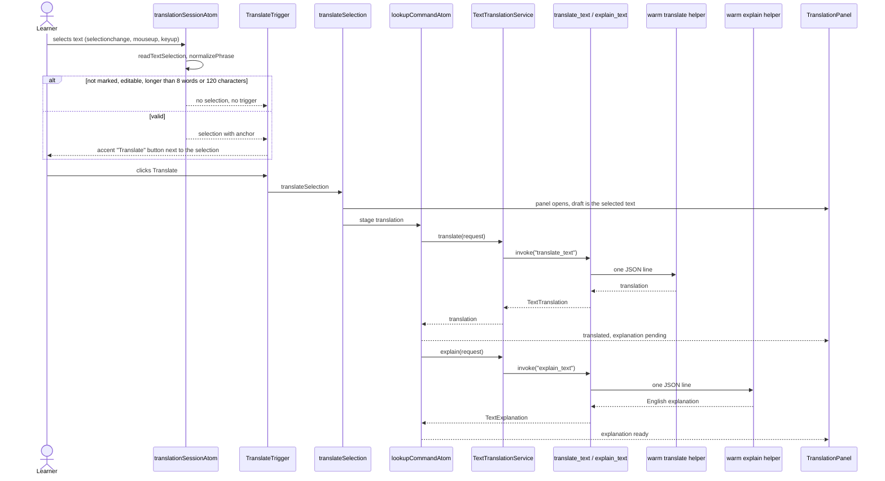
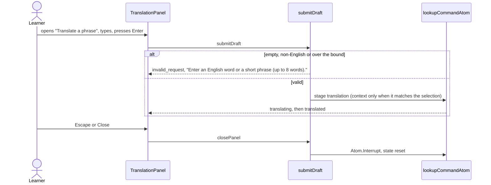
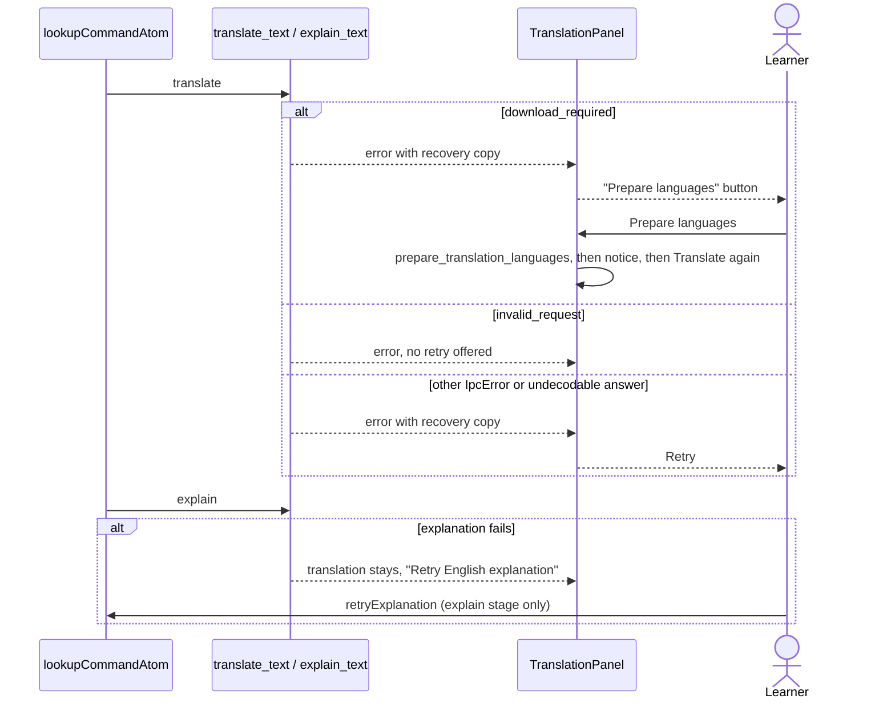

# Text translation flow

On-demand translation of a selected word or short phrase (up to 8 words and 120 characters) into
the learner's native language, plus a short English explanation. It is the approved exception to
English-only practice (PRODUCT_SPEC §4.2). Everything runs on this Mac through the bundled Swift
helper (macOS Translation and Apple Intelligence); nothing goes to Gemini or the conversation queue.

`TranslationLayer` is mounted by the app shell on Talk, Memory, review and the summary
(`isTranslatablePath`) and keyed by the path, so leaving a screen resets everything. Selectable text
carries `data-word-lookup`; a selection must start and end inside the same element.

## Select text and translate

The translation is shown as soon as it arrives; the explanation never blocks it. The translator and
the explainer are separate warm helper processes, so a slow explanation cannot delay a later
translation.

## Type a phrase

## Stale results

`lookupCommandAtom` is a `runtime.fn`: starting a lookup interrupts the previous one, and so does
`Atom.Interrupt` from closing the panel, editing the text, or preparing languages. An interrupted
lookup cannot write its result, so a slow older translation or explanation never replaces a newer
selection. The behaviour tests cover both stages.

## Failures

## Rust side

`translate_text` validates the text (the same rules as `normalizePhrase`), reads the native
language, records a cue exposure for the open session and sends one line to the warm translate
helper. `explain_text` does the same without the cue exposure and uses the explain helper. Both
helpers start lazily, are warmed at app start (`TranslationService::warm_up`), and are replaced after
a crash or a timeout. Status checks and language preparation still use a one-shot helper process.
