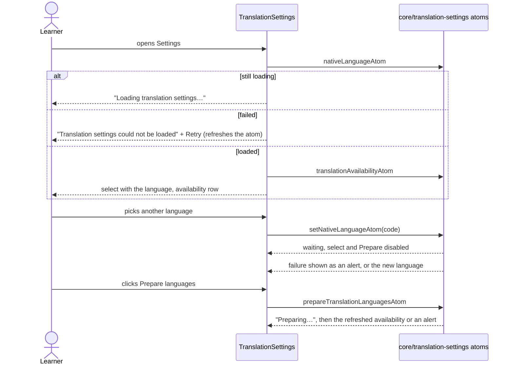

# Translation settings (UI)

The Settings group "Translation": the native-language select and the language-availability row with
"Prepare languages". State, IPC and the sequence diagrams for reading, changing and preparing live in
`core/translation-settings` (see its `flow.md`); this feature only renders them.

Availability is shown for the selected language only: a status reported for another language reads
"Checking language availability…" until the refreshed one arrives (`availabilityCopy`).
