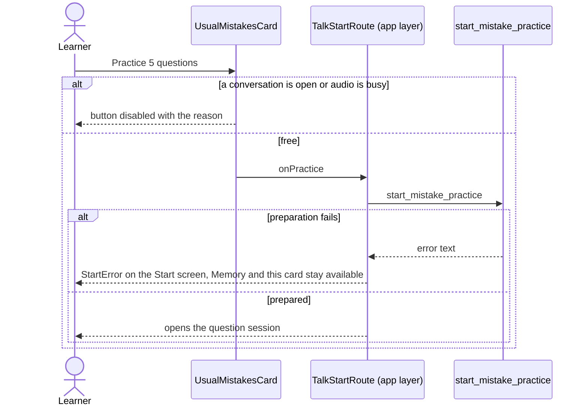

# Usual mistakes flow

The "Your usual mistakes" card on the Talk start screen: up to three repeated mistakes and a button
for the five-question practice (F12). The card appears only when a repeated, non-archived mistake
exists; choosing and preparing the questions is the existing mistake practice.

