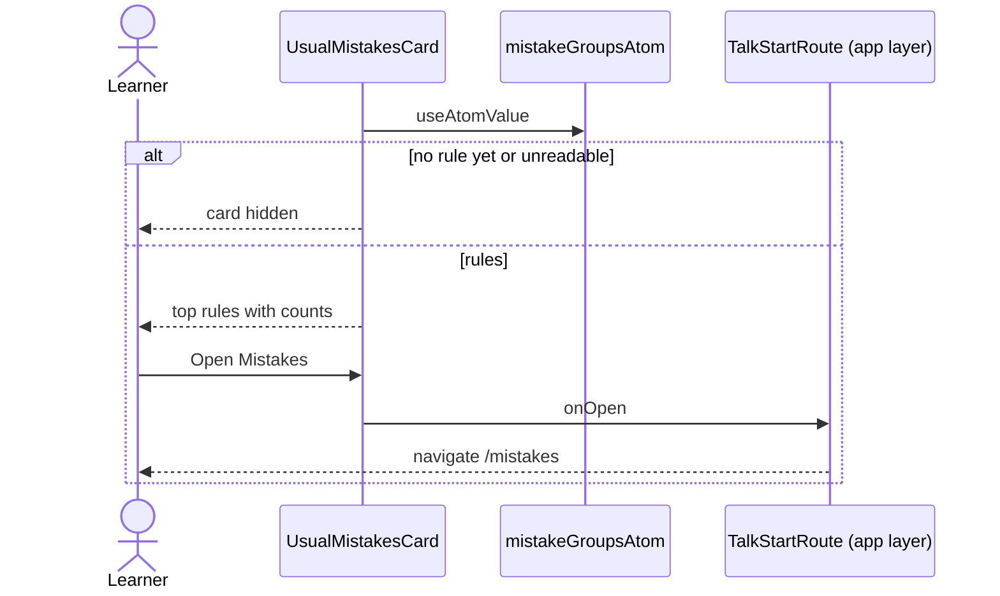

# Usual mistakes flow

The "Your usual mistakes" card on the Talk start screen: the three rules that come back most often
with how many mistakes each holds, and a button that opens Mistakes. It reads `mistakeGroupsAtom`
(`core/mistakes`) and shows nothing until a rule has a mistake.

