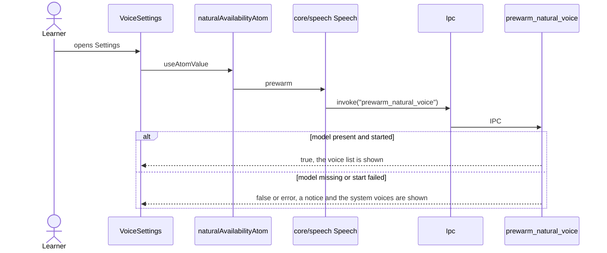
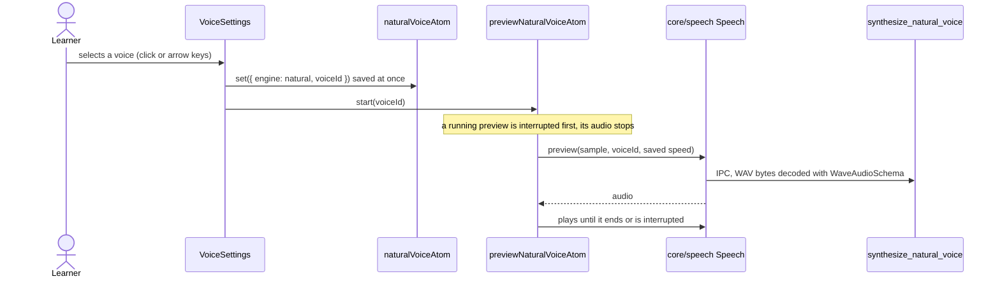
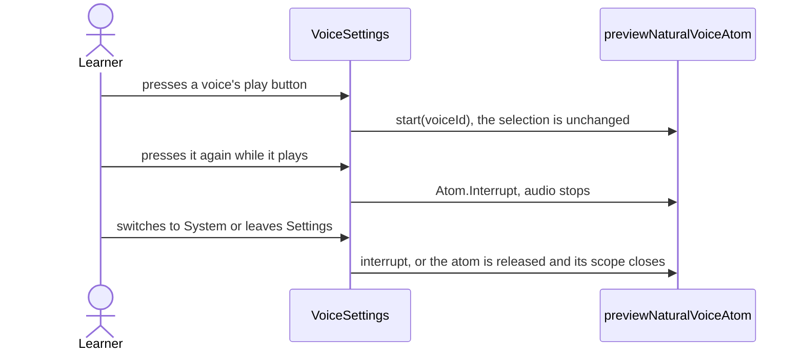
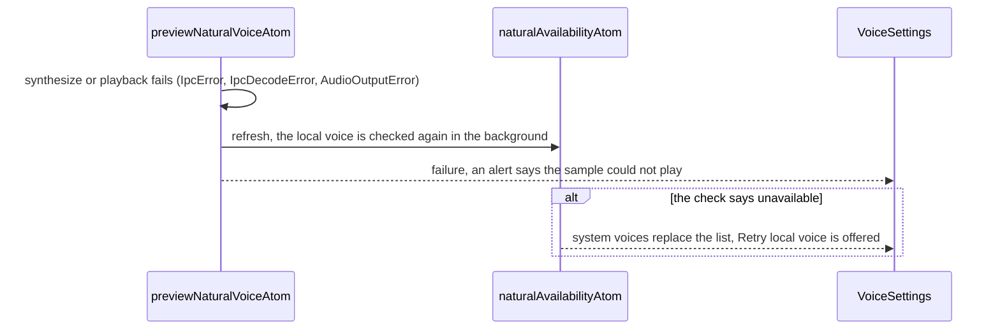
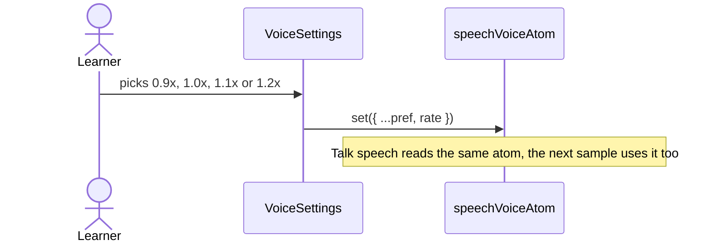

# Voice settings flow

Settings › Voice: engine, the ten natural voices, speed. The choice is stored by
`core/voice-preference`; the sample is synthesized by the bundled model through
`synthesize_natural_voice` and played by `core/speech` (`previewNaturalVoiceAtom`). When the local voice is unavailable
the host passes the system voice picker in `systemVoices` (the feature's own `SystemVoices`, fed by the app layer).

## Check the local voice

## Choose a voice

## Replay, stop and leave

## Sample fails

## Change the speed

## First run list

`VoiceList` is the compact variant for first run: the ten natural voices as one grouped list with a
play button per row, and the speed. It shares `useNaturalVoicePicker` with `VoiceSettings`, so
choosing a voice stores it, plays the sample and a second press on the play button stops it. While the
local voice is loading or unavailable a notice replaces the list.
