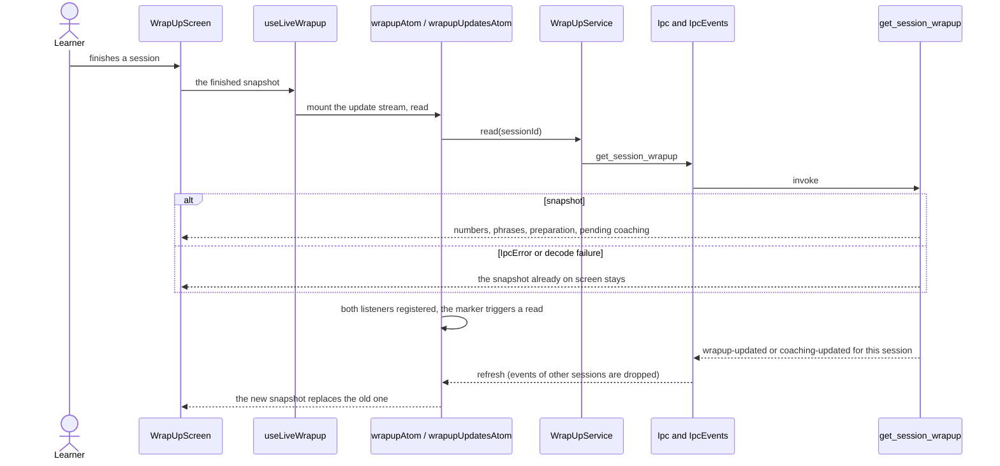
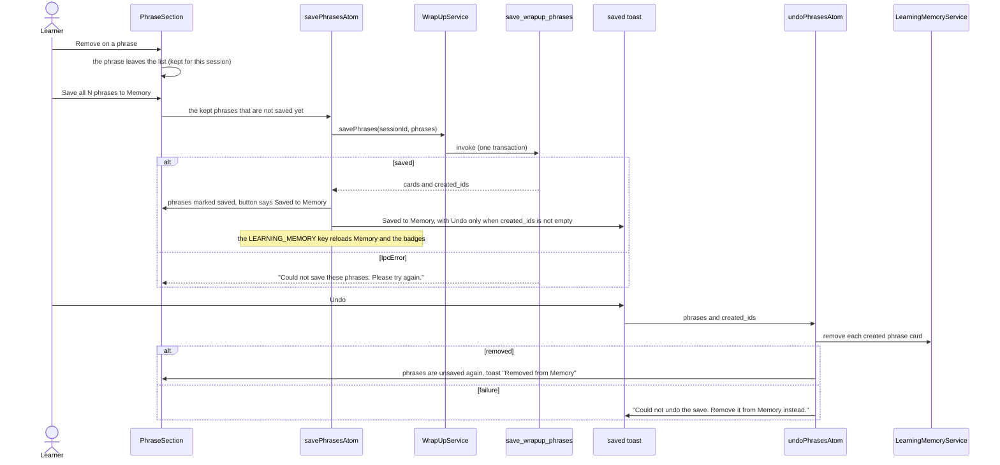
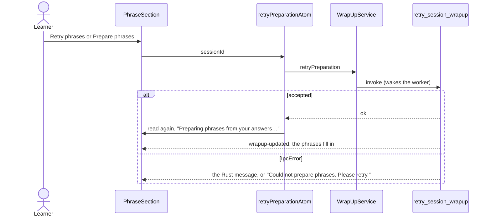
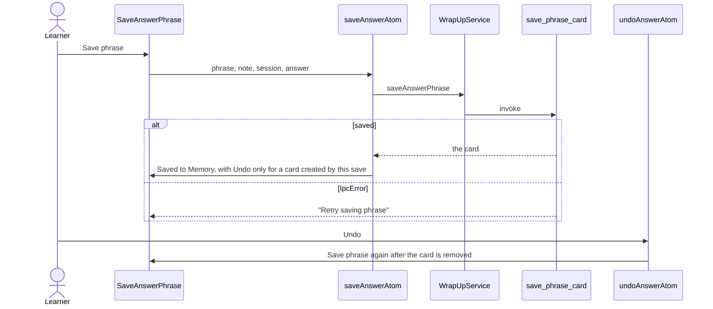

# Wrap-up

The numbers, the phrases worth learning and the saves of one finished session. `screens/wrap-up`
composes this feature with `features/coaching-note` (Your conversation); features never import each
other, so the screen hands the per-answer save to the review as a slot.

## Fill in live

The wrap-up opens with the snapshot `finish_practice_session` returned. The feature reads the session
again and keeps it current, so phrases and the "Still checking" line change as work lands in Rust.
The conversation never waits for either.

`IpcEvents.listenAll` registers both listeners and then emits a "listening" marker before any
event. The feature reads the summary when the marker arrives and again on each matching event, so a
result that lands between registration and the first read is not lost. There is no timer.

## Save all and Undo

Undo removes only the cards this save created; a phrase that was already in Memory is never deleted.

## Prepare phrases again

## Save the better version of one answer

`SaveAnswerPhrase` is rendered by the screen inside each ready review of "Your conversation". It
saves the improved wording of the first focus point with its explanation, or the whole natural
rewrite when there is no focus point, with the session and answer it came from. Nothing is offered
when the phrase is longer than a Memory card takes.

