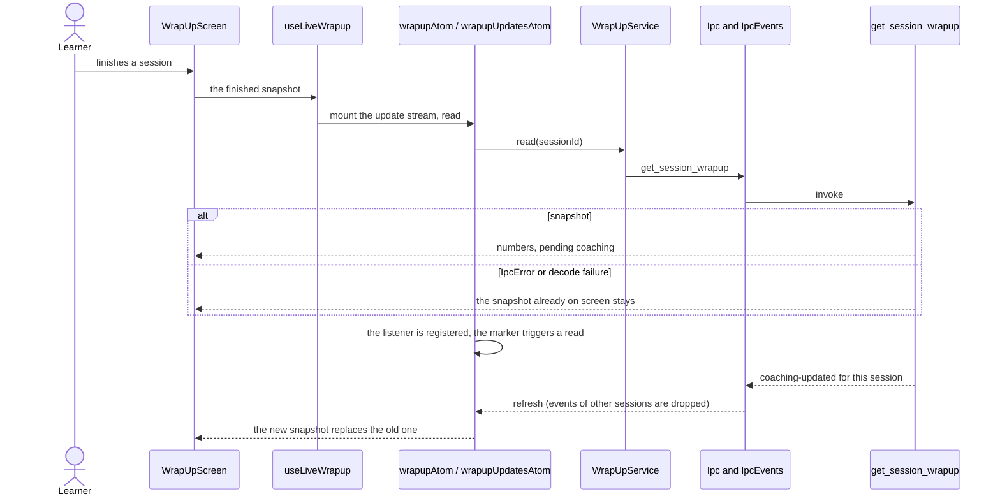
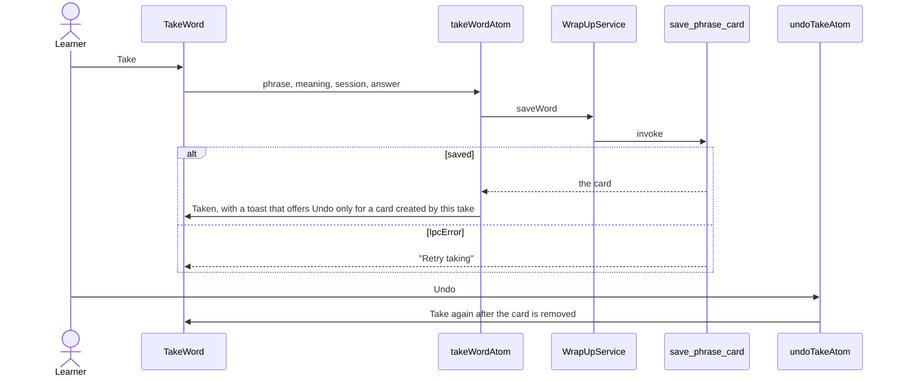

# Wrap-up

The numbers, the "Still checking" line and the Take button of one finished session. `screens/wrap-up`
composes this feature with `features/coaching-note` (the Debrief); features never import each
other, so the screen hands the Take button and the taken state to the Debrief.

## Fill in live

The wrap-up opens with the snapshot `finish_practice_session` returned. The feature reads the session
again and keeps it current, so the numbers and the "Still checking" line change as coaching lands in
Rust. The conversation never waits for it.

`IpcEvents.listenAll` registers the listener and then emits a "listening" marker before any
event. The feature reads the summary when the marker arrives and again on each matching event, so a
result that lands between registration and the first read is not lost. There is no timer.

## Take a word

`TakeWord` is rendered by the screen beside each word of a Debrief card that Rust offered (at most
five per session; the cap is a Rust decision). It saves the word as a Memory phrase with its meaning
and the session and answer it came from, so the existing weaving into later questions and the
"used on your own" evidence rules apply unchanged. `useIsTaken` tells the Debrief which words are
taken, for the "N of M taken" line and the summary.

