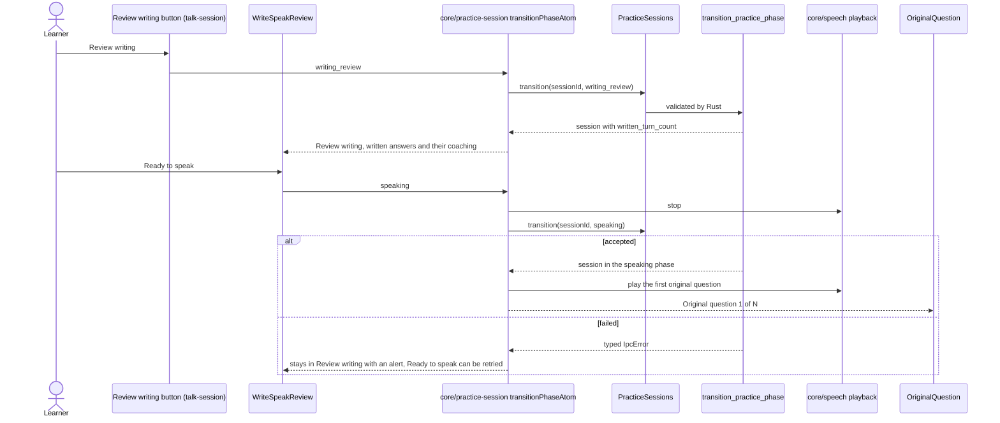
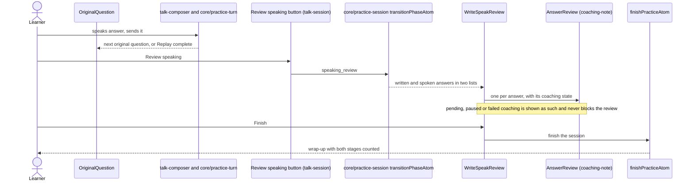

# Write, then speak flow

Write, then speak (F11) runs in four stages: `writing`, `writing_review`, `speaking`,
`speaking_review`. Rust owns the phase and the turn counts (`conversation` context); the frontend
asks for a change and shows what Rust answers. This feature owns the two review screens and the
"original question" prompt shown while the learner speaks. The composer, the chat and the stage
buttons belong to `talk-composer`, `talk-dialogue` and `talk-session`; `screens/talk`
composes them and hands this feature the dialogue, the history error and `AnswerReview` from
`coaching-note`.

Rust reports `written_turn_count` as 0 while the learner is writing; the counts are fixed when
the phase changes (`core/practice-session` helper `session-from-ipc`).

## Review the written answers and start speaking

No microphone capture or speech playback starts before Ready to speak succeeds.

## Speak the same questions and review them

Finish and Ready to speak are disabled while the session is busy, while another change is in
flight or while the learner is re-speaking an answer in the review (`sayAgainActiveAtom`, passed
in by the route as `isLocked`).
