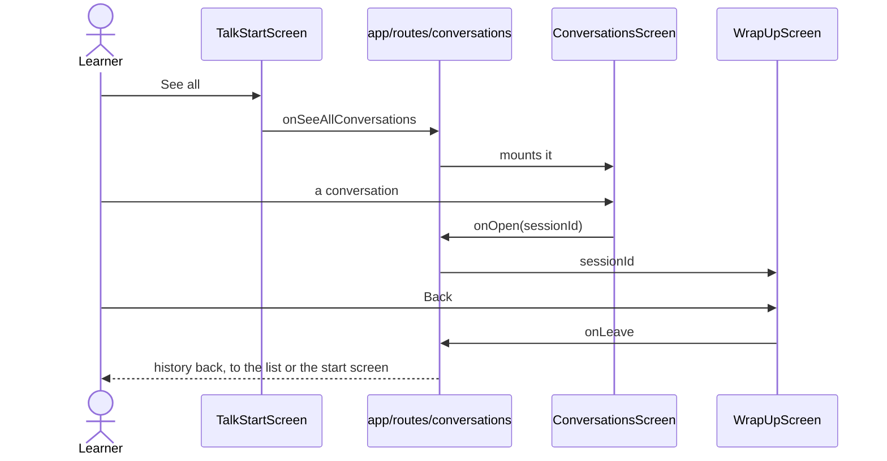

# Conversations screen

`/conversations` lists every finished conversation (`features/conversation-history`), with a Back
button that returns to where the learner came from. `app/routes/conversations` mounts it and opens a
row at `/conversations/$sessionId`, which renders `screens/wrap-up` for that session.

