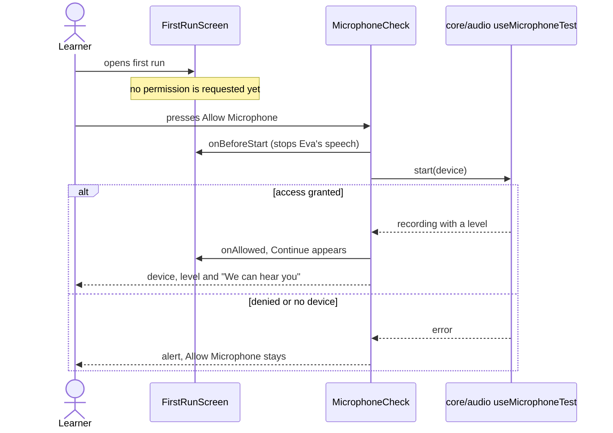

# First run screen

Composes the setup features for the `/welcome` route: Eva large and centred, the step label, a title
and lead, one grouped list, and a text Back with a primary Continue. The step bars and Skip setup sit
in the header. The screen owns only the current step and whether the microphone was allowed; the
router glue (`src/routes/first-run`) passes the practice-capture state, stops speech before the
microphone check and records the marker (`core/first-run`).

```text
FirstRunScreen
  header   English Trainer, StepBars (done / current / upcoming), Skip setup
  step 1   MicrophoneStep  -> features/microphone-settings MicrophoneCheck
  step 2   AiStep          -> features/ai-provider ProviderList, features/gemini-key GeminiKeyList
  step 3   VoiceStep       -> features/voice-settings VoiceList (natural voices, instant preview, speed)
  footer   Back, Continue (hidden on step 1 until the microphone is allowed), Start Talking on step 3
```

Each step wraps its content in `StepLayout`, which draws Eva (her mood follows the step: listening
while the level is live, happy once the AI is ready, speaking while a voice sample plays) and the copy
from `helpers/step-copy`.

## Allow the microphone



Going Back to step 1 later does not ask again: the screen remembers that the microphone was allowed.

## Choose the conversation AI

Choosing a provider saves it at once (`updateAiSettingsAtom`); only Gemini shows the key list. Saving
a key goes through `features/gemini-key`; see its flow.

## Choose a voice

Choosing a natural voice stores it and plays the sample; the play button on a row previews it without
choosing. Speed is stored with the voice preference. See `features/voice-settings/flow.md`.

## Leave

Start Talking records `finished`, Skip setup records `skipped`, and both open Talk start
(`core/first-run/flow.md`).
