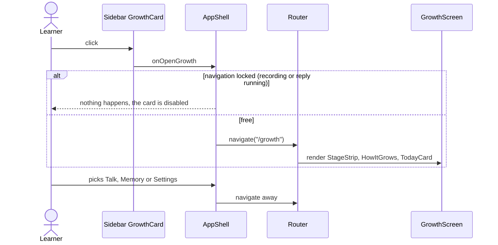

# Growth screen flow

`/growth` explains and shows how far Eva has grown. The sidebar growth card opens it; there is no
navigation entry of its own. The screen only composes the `eva-growth` feature; the numbers come from
`core/eva-growth`.

```
GrowthScreen
  StageStrip    six stages, "You are here"
  HowItGrows    drops, sunshine, days off
  TodayCard     Eva at her stage (asleep while napping), progress and today's gains
```


