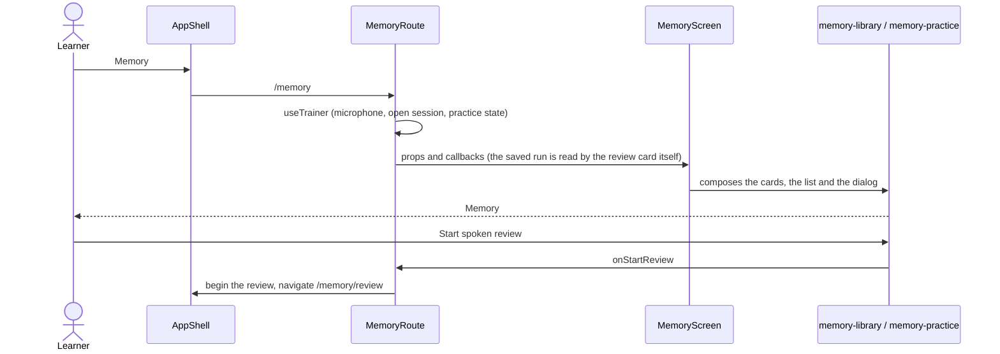

# Memory screen

Composes the Memory features for the `/memory` route. It owns layout only; what touches the router,
the open session or the microphone is passed in by `src/app/routes/memory`, which keeps the legacy Talk
and review state out of the screen.

```text
MemoryScreen
  header    title, subtitle, MemorySearch
  cards     ReviewCard                spoken review: items waiting, Start / Resume
            MistakePracticeCard       five questions built on the usual mistakes
            StatusSummary             where the saved items are
  list      LibraryList               tabs, Show archived, expandable rows
  dialog    DeleteMemoryDialog
```

Below the `narrow` breakpoint the cards stack. The data flows are in
`core/learning-memory/flow.md`, `features/memory-library/flow.md` and
`features/memory-practice/flow.md`.

## Open Memory



## Say it now

An opened row's Say it now reaches the route as `onSayNow(item)` through `LibraryList`'s `sayNow`
prop. The route begins a one-item review (`review.beginItem`) and navigates to `/memory/review`; the
summary there returns to Memory.
