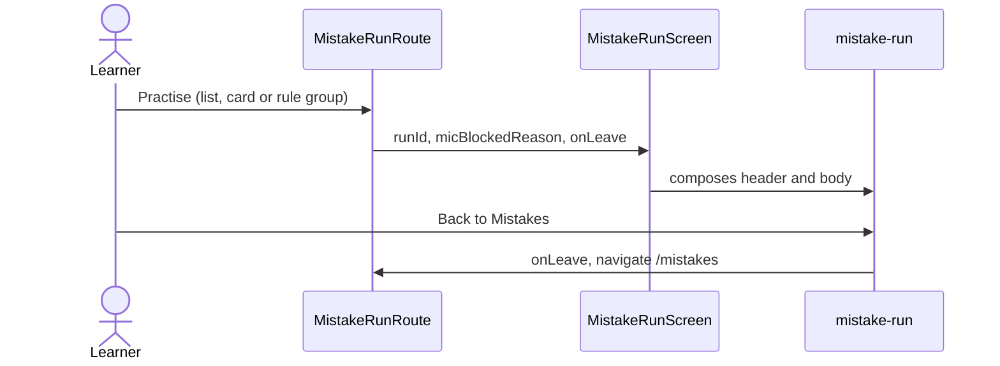

# Mistake practice screen

Layout for `/mistakes/practice/:runId`. Logic lives in `features/mistake-run`; the route
(`src/app/routes/mistakes`) passes the run id, the reason the microphone is unavailable and the way
back.

```text
MistakeRunScreen   RunHeader (progress, rule, End practice) + RunBody (exercise or summary)
```


