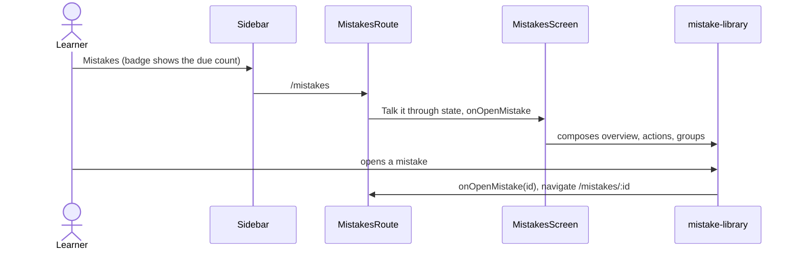

# Mistakes screen

Layout for `/mistakes` and `/mistakes/:mistakeId`. Logic lives in `features/mistake-library`; the
route (`src/app/routes/mistakes`) passes navigation and the F12 start.

```text
MistakesScreen      header (title, OverviewLine, PracticeActions) + MistakeGroups
MistakeCardScreen   MistakeCard (back to the list, archive returns to the list)
```


