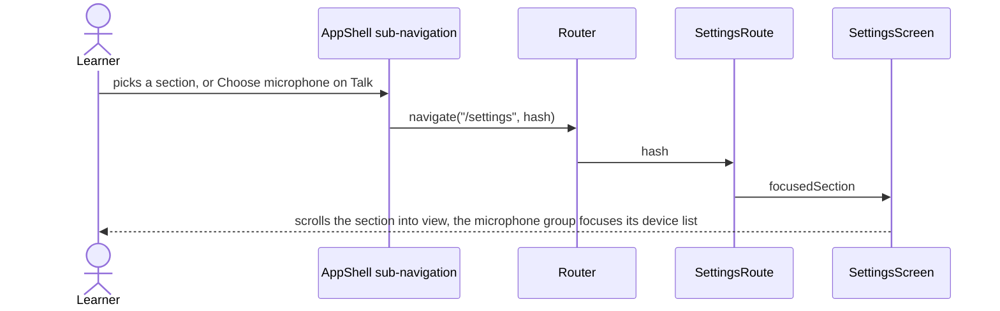

# Settings screen

Composes every settings feature for `/settings` and the Eva page for `/settings/eva`. It owns the
page layout, the section order shared with the sidebar sub-navigation (`sections.ts`) and the
Eva link; everything that touches the open conversation, the system voices or the router is passed
in by the app layer (`src/routes/settings`), which keeps the legacy Talk state out of the screen.

```text
SettingsScreen
  header        title and the privacy line
  Microphone, Conversation AI (+ Gemini key), Voice (+ system voices), Speech recognition,
  Eva link, Conversation flow, Translation, Personalisation (About you, Glossary),
  Privacy, Usage, Appearance, Setup details
SettingsEvaScreen
  back link, heading, EvaSettings
```

The sidebar lists the same sections in the same order. A section entry navigates to
`/settings#<id>`, Eva to `/settings/eva`; the screen scrolls the hash target into view.

## Open a section



## What each control launches

| Control | Goes to |
| :--- | :--- |
| Eva › Open | `/settings/eva` |
| ← Settings on the Eva page | `/settings` |
| Setup details › Run setup again | the first-run flow, disabled while a conversation or recording is open |
| Microphone › Record | stops Eva's speech first (`onBeforeRecord`) |
