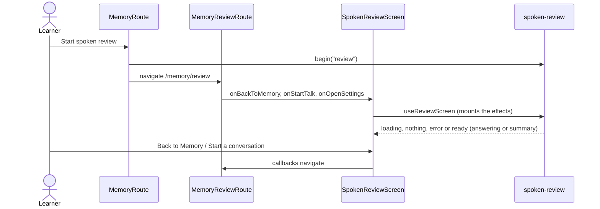

# Spoken review screen

Composes the `spoken-review` feature for `/memory/review` and for the warm-up shown by the Talk start
screen. It owns the layout and the way out; the review state lives in the feature's atoms and the
routes pass only navigation.

```text
SpokenReviewScreen
  loading / nothing / error   ReviewNotice
  header                      ReviewHeader   Memory › Spoken review, progress pips, End review
  stage                       ReviewStage    Eva, phrase bar, situation, live transcript, result
  composer                    ReviewComposer microphone, level, Skip or Cancel (while answering)
  summary                     ReviewSummary  Review done, one line per item
```



The warm-up is the same screen rendered inline by `TalkStartRoute` after `begin("warmup")`. When the
review reaches its summary, the route starts the conversation once with the options it kept.
