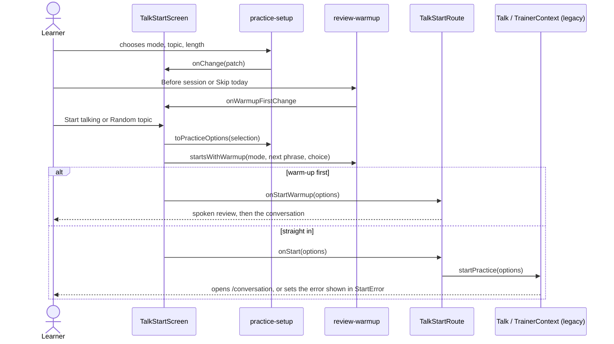

# Talk start screen

Composes the start-of-practice features for the `/` route. It owns layout and the two pieces of
ephemeral state that connect features (the practice selection and the warm-up choice); everything
that touches Rust, the open session or the router is passed in by the app layer
(`src/routes/talk-start`), which keeps the legacy Talk and Memory state out of the screen.

```text
TalkStartScreen
  left column   StartGreeting (Eva + greeting)
                ResumeCard            when a conversation is open
                ModeChoice, TopicChoice   otherwise
                ActivityCard          26-week grid, from local data
                LengthChoice + StartBar   otherwise
                StartError            when starting failed
  right column  WarmupCard            when review data is ready
                UsualMistakesCard     when a repeated mistake exists
                WeekCard              minutes spoken this week
```

Below the `narrow` breakpoint the right column stacks under the left one.

## Start a conversation



## What each card launches

| Control | Goes to |
| :--- | :--- |
| Continue | `startOrResumePractice` in the open conversation |
| Review now | `/memory` |
| Practice 5 questions | `startMistakePractice` (F12), then `/conversation` |
