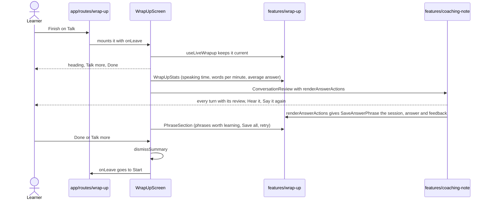

# Wrap-up screen

`screens/wrap-up` is the focused full page after Finish (the shell hides the sidebar). It composes
`features/wrap-up` (numbers, phrases, saves) with `features/coaching-note` (Your conversation) and
passes the first into the second as a slot, because features never import each other.
`app/routes/wrap-up` only mounts it and navigates; the screen reads `practiceStateAtom` and renders nothing
unless the session is completed.

Order: header and actions, three numbers, Your conversation (only when the session had answers),
Phrases worth learning. The conversation and the phrases fill in while the learner reads; nothing
on this screen blocks on coaching.
