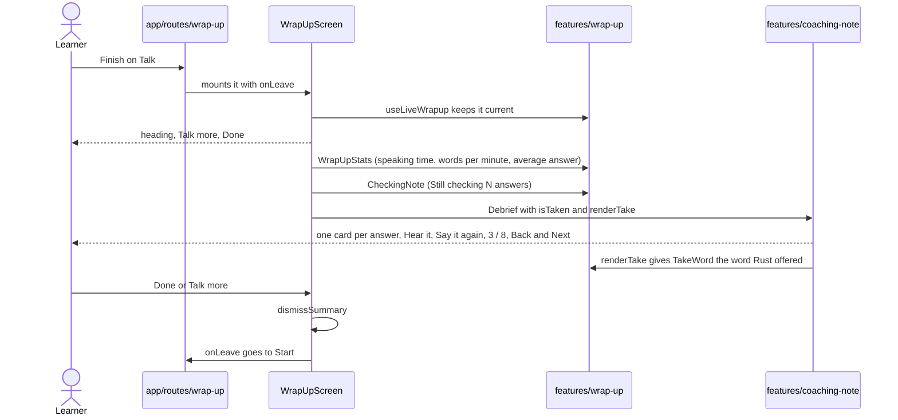

# Wrap-up screen

`screens/wrap-up` is the focused full page after Finish (the shell hides the sidebar). It composes
`features/wrap-up` (numbers, Take) with `features/coaching-note` (the Debrief) and passes the first
into the second as a slot, because features never import each other.
`app/routes/wrap-up` mounts it, navigates, and starts the Mistakes run behind "Practise this rule"
(`startMistakeRunAtom` with kind `rule`, then dismisses the summary and opens `/mistakes/practice/$runId`),
passing `onPractiseRule` and `isStartingRun` down to the Debrief because features never import each other; the screen reads `practiceStateAtom` and renders nothing
unless the session is completed.

With a `sessionId` the same screen opens an earlier conversation (`/conversations/$sessionId`): it reads
the summary with `wrapupAtom` (`get_session_wrapup`), titles the page "Your conversation" and shows
one Back button instead of Talk more and Done. Back returns to where the learner came from and the
live summary in `practiceStateAtom` is left alone.

Order: header and actions, three numbers, the "Still checking" line, the Debrief (only when the
session had answers). The Debrief fills in while the learner reads; nothing on this screen blocks
on coaching.
